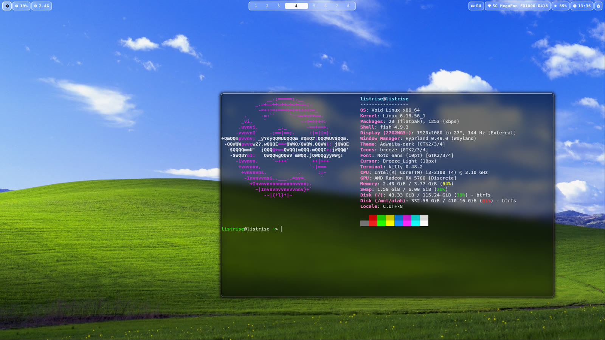

# listrr-dots

жосткие дотсы для **Hyprland** и **Waybar** на Void Linux.



---

## что внутри

```
hypr/
├── hyprland.conf        # точка входа, подключает остальные файлы
├── looknfeel.conf       # обводки, скругления, тени, blur, анимации
├── monitors.conf        # монитор + GDK_SCALE (правь под себя!)
├── input.conf           # раскладки us/ru, тачпад, чувствительность
├── envs.conf            # переменные окружения (Wayland, курсор, Qt)
├── windows.conf         # общие правила окон
├── autostart.conf       # что запускается при старте
├── bindings.conf        # запуск приложений
├── bindings/            # tiling / media / utilities
├── apps/                # правила под конкретные приложения
├── theme_override.conf  # горячее применение темы через hyprctl
├── hyprlock.conf        # экран блокировки
└── way/                 # Waybar-тема omarchy (опционально)

waybar/
├── config.jsonc         # верхняя панель
├── style.css            # «стеклянный» стиль панели
├── config-dock.jsonc    # нижний док (опционально)
├── style-dock.css
└── settings_state.json  # состояние панели
```

---

## установка

```bash
git clone https://github.com/listrrise/listrr-dots.git ~/listrr-dots
cd ~/listrr-dots
./install.sh
```

скрипт:

1. проверяет зависимости и говорит, чего не хватает;
2. делает бэкап текущих `~/.config/hypr` и `~/.config/waybar`
   в `~/.config/dots-backup-<дата>-<время>/`;
3. копирует конфиги в `~/.config/`;
4. подставляет твой `$HOME` вместо `/home/блаблабла` в путях конфигов;
5. создаёт заглушку `~/.config/omarchy/current/theme/hyprland.conf`, если у тебя нет omarchy
   (иначе Hyprland будет ругаться на `source`).

после установки перезапусти сессию Hyprland: `Super+Esc` → **Reload**, либо выйди и зайди снова.

### опции

```bash
./install.sh --link        # не копировать, а сделать симлинки (удобно обновлять через git pull)
./install.sh --copy        # копировать принудительно (по умолчанию)
./install.sh --no-backup   # без бэкапа существующих конфигов
./install.sh --uninstall   # убрать конфиги и восстановить последний бэкап
./install.sh --help
```

---

##зависимости

**обязательно:**

| аакет | зачем |
| --- | --- |
| `hyprland` | сам композитор |
| `waybar` | панель |

**нужны для того, что прописано в конфигах** (без них будут ошибки в логе и «пустые» места):

| пакет | зачем |
| --- | --- |
| `kitty` | терминал (`Super+V`) |
| `firefox` | браузер (`Super+B`) |
| `nautilus` | файловый менеджер (`Super+E`) |
| `fuzzel` | лаунчер (`Super+D`) |
| `mako` | уведомления |
| `hyprlock` | экран блокировки (`Super+Esc`) |
| `hyprshot` | скриншоты |
| `swaybg` | обои |
| `swayosd-server` | OSD громкости/яркости |
| `wl-clip-persist` | история буфера |
| `fcitx5` | раскладка/IME |
| `playerctl` | управление плеером с клавиш |
| `jq` | используется в media-биндингах |
| `btop`, `nvim`, `yazi`, `lazygit`, `lazydocker` | TUI-приложения |
| `JetBrainsMono Nerd Font` | шрифт иконок Waybar |
| `MacTahoe-cursors` | курсор |

правь под себя в первую очередь `hypr/monitors.conf`, `hypr/bindings.conf`
и пути к `waybar-settings` в `waybar/config.jsonc`.

---

## горячие клавиши

| хк | действие |
| --- | --- |
| `Super+V` / `Super+E` / `Super+B` | терминал / файлы / браузер |
| `Super+N` / `Super+T` | nvim / btop |
| `Super+Y` / `Super+L` / `Super+C` | yazi / lazygit / lazydocker |
| `Super+W` | gazelle (Wi-Fi) |
| `Super+D` | лаунчер (fuzzel) |
| `Super+Q` | закрыть окно |
| `Super+F` | фулскрин |
| `Super+A` | плавающее окно |
| `Super+J` | переключить split |
| `Super+1..8` | рабочий стол 1–8 |
| `Super+←` / `Super+→` | пред./след. рабочий стол |
| `Ctrl+Super+←/→` | отправить окно на пред./след. стол |
| `Super+Alt+стрелки` | поменять окна местами |
| `Alt+Tab` | следующее окно |
| `Super+-` / `Super+=` | ресайз окна |
| `Super+ЛКМ` / `Super+ПКМ` | тащить / ресайзить окно |
| `Super+Esc` | заблокировать (`hyprlock`) |
| `Super+Shift+Space` | скрыть/показать панель |
| `Super+Ctrl+Space` | следующая обоина темы |
| `Super+,` | закрыть последнее уведомление |
| `Print` / `Super+Shift+S` | скриншот экрана / области |
| `Alt+Shift` | смена раскладки us/ru |
| `Fn`-клавиши | громкость/яркость/плеер через `swayosd` |

---

## удаление

```bash
./install.sh --uninstall
```

конфиги будут убраны, а последний бэкап из `~/.config/dots-backup-*` вернётся на место.
